<div align="center">

# Come Jave

**Pide tu almuerzo en el campus sin hacer fila.**
App móvil de pedidos para los estudiantes de la Pontificia Universidad Javeriana Cali: elige restaurante, arma el carrito, paga en efectivo o con Nequi y sigue el estado de tu pedido.

[](https://github.com/Niko2361920/come-jave-back/actions/workflows/ci.yml)


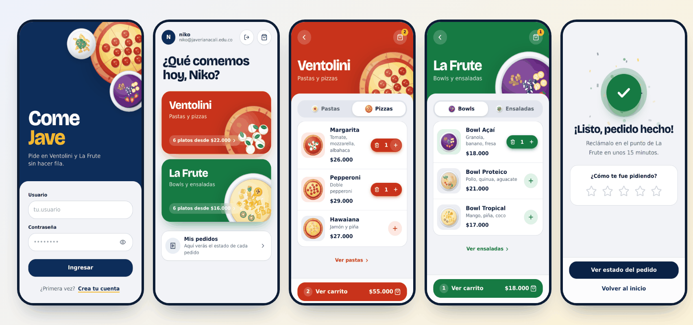

</div>

## Contenido

1. [Qué hace la app](#1-qué-hace-la-app)
2. [Capturas](#2-capturas)
3. [Inicio rápido](#3-inicio-rápido)
4. [Arquitectura y estructura](#4-arquitectura-y-estructura)
5. [Tecnologías](#5-tecnologías)
6. [Instalación](#6-instalación)
7. [Variables de entorno](#7-variables-de-entorno)
8. [Cómo correr el proyecto](#8-cómo-correr-el-proyecto)
9. [API](#9-api)
10. [Flujo de la app](#10-flujo-de-la-app)
11. [Diseño, ilustraciones y animaciones](#11-diseño-ilustraciones-y-animaciones)
12. [Menú](#12-menú)
13. [Pruebas y CI](#13-pruebas-y-ci)
14. [Despliegue](#14-despliegue)
15. [Solución de problemas](#15-solución-de-problemas)
16. [Ideas para seguir mejorando](#16-ideas-para-seguir-mejorando)
17. [Equipo](#17-equipo)

## 1. Qué hace la app

**Para el estudiante**

- Inicia sesión con su correo institucional (`@javerianacali.edu.co`) o con Google.
- Elige entre **Ventolini** (pastas y pizzas) y **La Frute** (bowls y ensaladas), cada uno con su color.
- Agrega y quita platos con un selector − / +; el carrito se conserva aunque recargue la página.
- Paga en **efectivo** (al reclamar) o con **Nequi** (copia el número, transfiere y registra el comprobante).
- Revisa un resumen antes de enviar, califica la experiencia con estrellas y consulta **Mis pedidos**, donde puede cancelar los pendientes.

**Para el equipo**

- API REST en NestJS con autenticación por Firebase, validación estricta, permisos por rol, stock atómico y documentación Swagger.
- Frontend con **modo demo**: funciona sin servidor ni Firebase, ideal para mostrar la app o diseñar pantallas.
- Pruebas automáticas (unitarias y e2e) y CI en GitHub Actions.

## 2. Capturas

<table>
  <tr>
    <td>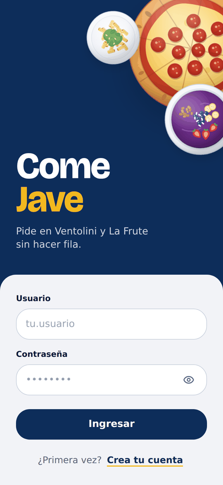</td>
    <td>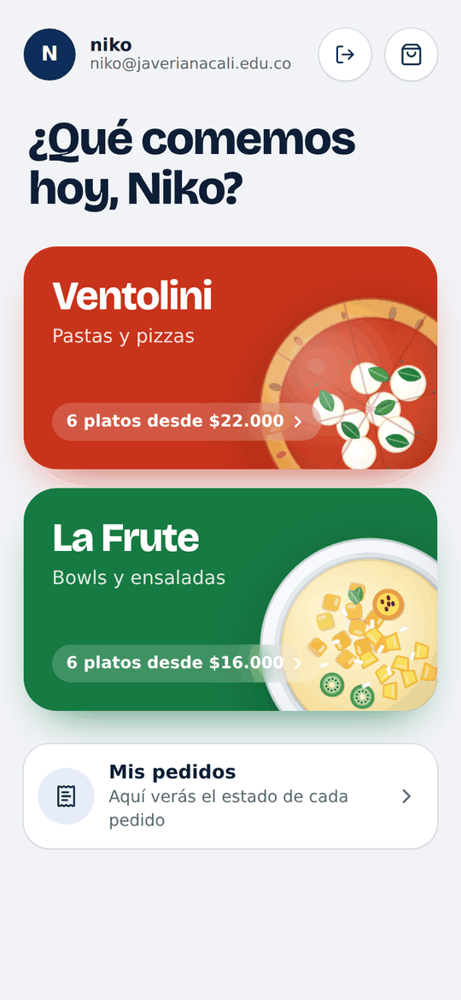</td>
    <td>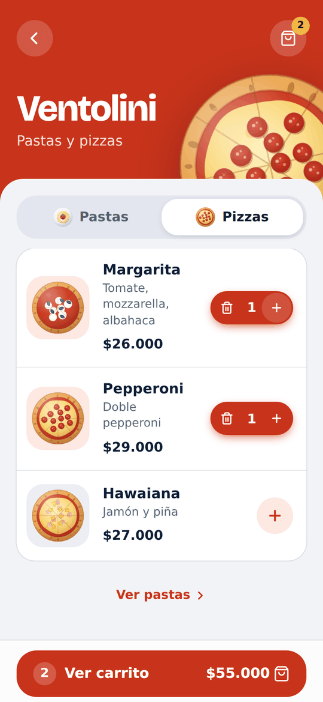</td>
    <td>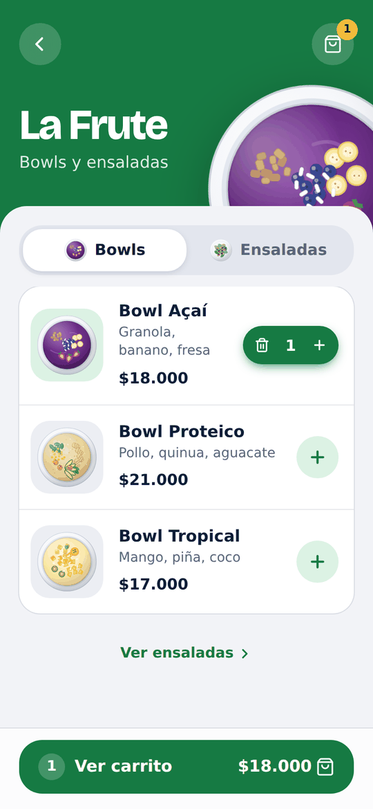</td>
  </tr>
  <tr>
    <td align="center">Login</td>
    <td align="center">Inicio</td>
    <td align="center">Ventolini</td>
    <td align="center">La Frute</td>
  </tr>
  <tr>
    <td>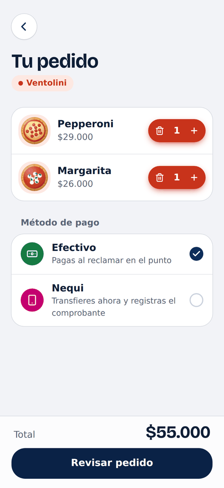</td>
    <td>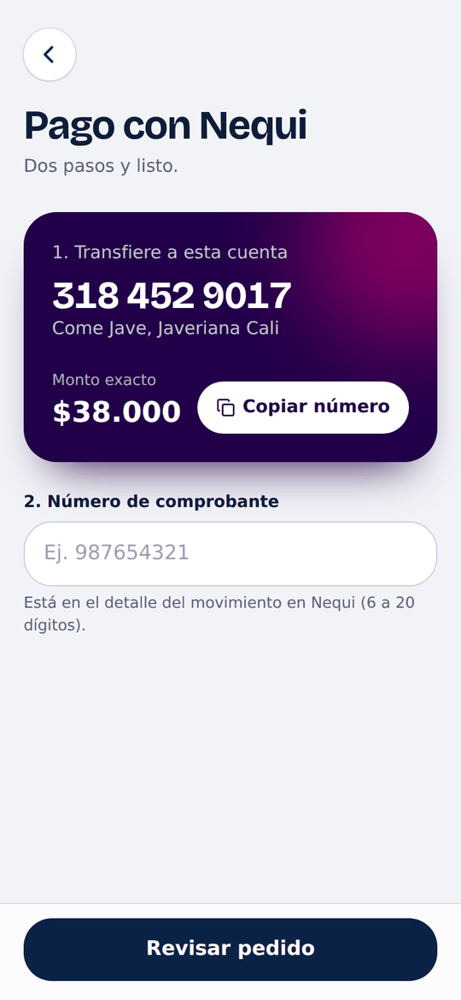</td>
    <td>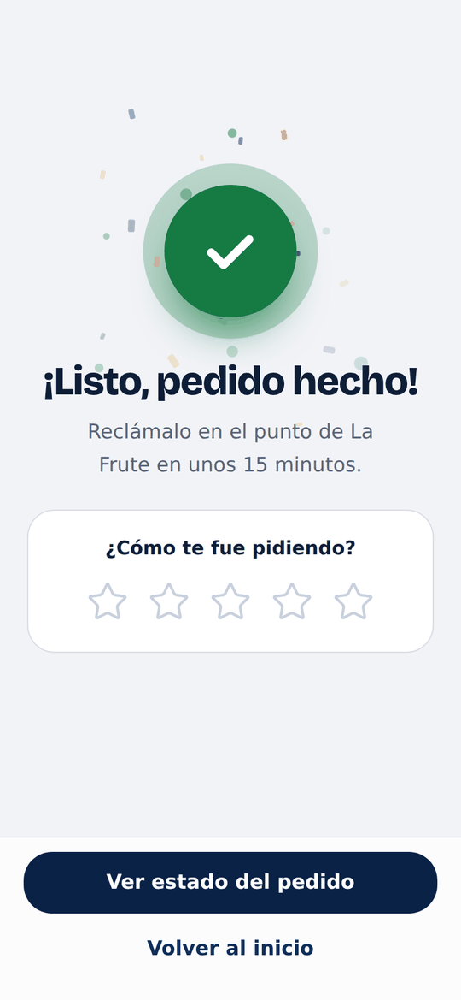</td>
    <td>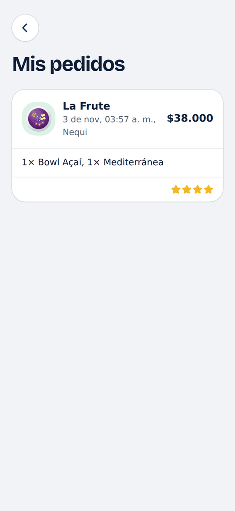</td>
  </tr>
  <tr>
    <td align="center">Carrito y pago</td>
    <td align="center">Nequi</td>
    <td align="center">Pedido enviado</td>
    <td align="center">Mis pedidos</td>
  </tr>
</table>

## 3. Inicio rápido

### Ver la app en 2 minutos (modo demo, sin backend ni Firebase)

```bash
git clone https://github.com/Niko2361920/come-jave-back.git
cd come-jave-back/frontend/app
npm install
npm run dev          # abre http://localhost:8080
```

Entra con cualquier usuario y contraseña: en modo demo no se valida nada y los pedidos se guardan en el navegador.

### Correr todo el proyecto (backend + frontend)

```bash
# 1) Backend (terminal 1), desde la raíz del repo
npm install
cp .env.example .env          # ya viene listo para desarrollo con SQLite y sin Firebase
npm run seed                  # carga el menú
npm run start:dev             # API en http://localhost:3000  ·  Swagger en /docs

# 2) Frontend (terminal 2)
cd frontend/app
npm install
cp .env.example .env          # completa VITE_FIREBASE_* con los datos de tu proyecto y VITE_API_URL
npm run dev                   # app en http://localhost:8080
```

> Los pedidos viven en la API solo cuando el frontend tiene **Firebase y `VITE_API_URL`** configurados. Si falta alguno (por ejemplo, si no creas el `.env`), la app usa el modo demo (ver [sección 7](#modos-del-frontend)).

## 4. Arquitectura y estructura

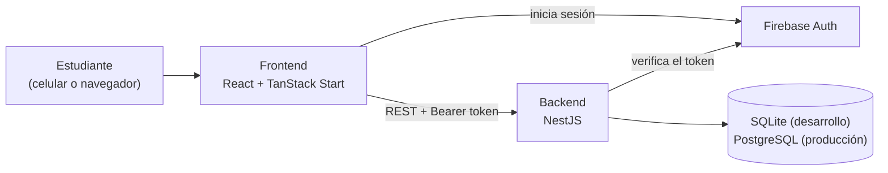

```text
.
├─ src/                          Backend NestJS
│  ├─ auth/                      Guard de Firebase (token, dominio institucional, admin)
│  ├─ users/ products/ orders/   Módulos de la API (controller, service, DTOs, entidades)
│  ├─ config/                    Validación de variables de entorno
│  ├─ database/                  data-source (CLI de TypeORM) y seed del menú
│  ├─ migrations/                sqlite/ y postgres/
│  ├─ health/                    GET /health
│  └─ app.setup.ts               ValidationPipe, CORS, helmet y Swagger (compartido con los e2e)
├─ test/                         Pruebas e2e de la API
├─ postman/                      Colección de Postman lista para importar
├─ docs/screenshots/             Capturas que usa este README
├─ .github/workflows/ci.yml      CI: lint, tipos, pruebas y build de backend y frontend
└─ frontend/app/                 App móvil (React)
   ├─ public/                    Íconos, manifest e imagen para compartir el enlace
   └─ src/
      ├─ routes/                 index.tsx orquesta las pantallas; __root.tsx define el <head>
      ├─ features/comejave/      screens/ (auth, home, menú, checkout), tipos y validaciones
      ├─ components/comejave/    UI (botones, campos, diálogo, aviso), layout y DishArt
      │  └─ dishes/              Ilustraciones de los 12 platos (SVG generado con código)
      ├─ assets/dishes/          Aquí van las fotos reales de los platos (opcional)
      ├─ hooks/                  useAuth, useCart, useOrders, useScreenHistory, useBump
      └─ lib/                    api.ts, firebase.ts, config.ts, cart.ts, menú, fotos
```

## 5. Tecnologías

| Capa | Tecnologías |
| --- | --- |
| Backend | Node.js 24, NestJS 12, TypeScript, TypeORM, SQLite (`better-sqlite3`) o PostgreSQL, Firebase Admin, Helmet, Throttler, Swagger |
| Frontend | React 19, TanStack Start / Router / Query, Tailwind CSS 4, Firebase Auth, Lucide, fuente Bricolage Grotesque |
| Calidad | Vitest (backend y frontend), oxlint y ESLint, Prettier, TypeScript estricto, GitHub Actions |

## 6. Instalación

**Requisitos:** Node.js 24 (ver `.nvmrc`; con `nvm use` se activa solo) y npm. El frontend también trae `bun.lock` por Lovable, pero `npm` funciona igual.

```bash
git clone https://github.com/Niko2361920/come-jave-back.git
cd come-jave-back
npm install                      # backend
cd frontend/app && npm install   # frontend
```

## 7. Variables de entorno

### Backend (`.env` en la raíz)

Mínimo para desarrollo local (SQLite, sin Firebase):

```env
PORT=3000
DB_TYPE=sqlite
DB_DATABASE=data/app.sqlite
AUTH_ENABLED=false
```

| Variable | Por defecto | Descripción |
| --- | --- | --- |
| `PORT` | `3000` | Puerto de la API |
| `DB_TYPE` | `sqlite` | `sqlite` o `postgres` |
| `DB_DATABASE` | `data/app.sqlite` | Archivo SQLite o nombre de la base en Postgres |
| `DB_HOST`, `DB_PORT`, `DB_USERNAME`, `DB_PASSWORD` | – | Obligatorias con `DB_TYPE=postgres` |
| `DB_SYNCHRONIZE` | `true` en dev, `false` en producción | Con `true` TypeORM crea el esquema solo; **prohibido en producción**, ahí se usan migraciones |
| `DB_LOGGING` | `false` | Muestra las consultas SQL |
| `AUTH_ENABLED` | `true` | Con `false` no se verifica Firebase (solo desarrollo, **prohibido en producción**) |
| `FIREBASE_PROJECT_ID` | – | Obligatoria si `AUTH_ENABLED=true` |
| `ALLOWED_EMAIL_DOMAIN` | `javerianacali.edu.co` | Dominio permitido para usuarios |
| `ADMIN_EMAILS` | vacío | Correos admin separados por coma (pueden ser de otro dominio) |
| `CORS_ORIGINS` | `http://localhost:8080,http://localhost:5173` | Orígenes permitidos, separados por coma |
| `SWAGGER_ENABLED` | `true` en dev, `false` en producción | Documentación en `/docs` |
| `SEED_STOCK` | `200` | Stock inicial de cada plato al correr `npm run seed` |

Con `AUTH_ENABLED=false` la API acepta cualquier petición como admin. Para simular a otro usuario se envían los headers `x-dev-email` y `x-dev-admin: false`.

### Frontend (`frontend/app/.env`, ver `.env.example`)

| Variable | Descripción |
| --- | --- |
| `VITE_FIREBASE_*` | Configuración de Firebase Auth (API key, auth domain, project id, app id…) |
| `VITE_API_URL` | URL del backend, sin barra final (ej. `http://localhost:3000`) |
| `VITE_NEQUI_NUMBER` | Número de Nequi que recibe las transferencias (opcional) |
| `VITE_NEQUI_ACCOUNT_NAME` | Nombre que se muestra bajo el número (opcional) |
| `VITE_SITE_URL` | Dirección pública de la app, sin barra final; hace que la vista previa al compartir el enlace muestre la imagen (opcional) |

<a id="modos-del-frontend"></a>

**El frontend tiene dos modos:**

| Modo | Cuándo | Qué pasa |
| --- | --- | --- |
| **Completo** | Hay `VITE_API_URL` **y** Firebase configurado | Sesión real (solo correos `@javerianacali.edu.co` verificados), menú enlazado a la API por `sku`, pedidos en la base de datos y cancelables mientras estén pendientes |
| **Demo** | Falta alguno de los dos | Cualquier usuario entra; sesión, historial y calificaciones se guardan en `localStorage` |

## 8. Cómo correr el proyecto

### Backend

```bash
npm run migration:run   # opcional: con DB_SYNCHRONIZE=false las migraciones también corren solas al arrancar
npm run seed            # carga el menú (idempotente: crea o actualiza por sku)
npm run start:dev       # http://localhost:3000
```

Comprobación rápida: `GET http://localhost:3000/health` · Swagger: `http://localhost:3000/docs`.

Producción:

```bash
npm run build
npm run start:prod      # exige AUTH_ENABLED=true y DB_SYNCHRONIZE=false
```

Generar una migración tras cambiar una entidad: `npm run migration:generate -- src/migrations/<motor>/NombreCambio`.

> SQLite escribe en un archivo local: en plataformas con disco efímero (como Vercel) los datos se pierden. Para desplegar usa PostgreSQL.

### Frontend

```bash
cd frontend/app
npm run dev        # http://localhost:8080 (si está ocupado, Vite usa el siguiente puerto)
npm run build      # build de producción
npm run preview    # sirve el build
```

### Scripts

| Proyecto | Scripts |
| --- | --- |
| Backend | `start`, `start:dev`, `build`, `start:prod`, `lint`, `typecheck`, `format`, `test`, `test:e2e`, `test:cov`, `seed`, `migration:run`, `migration:generate`, `migration:revert` |
| Frontend | `dev`, `build`, `preview`, `lint`, `typecheck`, `format`, `test` |

## 9. API

Autenticación: `Authorization: Bearer <ID token de Firebase>`. Rutas públicas: `GET /health`, `GET /products`, `GET /products/:id`. Las marcadas **Admin** requieren un correo en `ADMIN_EMAILS`.

| Recurso | Endpoints |
| --- | --- |
| Usuarios | `POST /users`, `GET /users/me`, `GET /users` (Admin), `GET/PUT/DELETE /users/:id` |
| Productos | `GET /products` (filtros: `name`, `minPrice`, `maxPrice`, `minStock`, `maxStock`), `GET /products/:id`; `POST`, `PUT`, `DELETE` (Admin) |
| Pedidos | `POST /orders`, `GET /orders/me`, `GET /orders/:id`, `PUT /orders/:id/cancel`; `GET /orders`, `PUT /orders/:id`, `DELETE /orders/:id` (Admin) |

Reglas importantes:

- Los DTOs se validan globalmente: los campos desconocidos devuelven `400`.
- El dueño de un pedido sale siempre del token, no del body.
- Crear un pedido **descuenta el stock de forma atómica**; cancelarlo (solo si está pendiente) lo devuelve.
- Pagar con Nequi exige `paymentReference` (6 a 20 dígitos).
- Límite de 100 peticiones por minuto por IP.

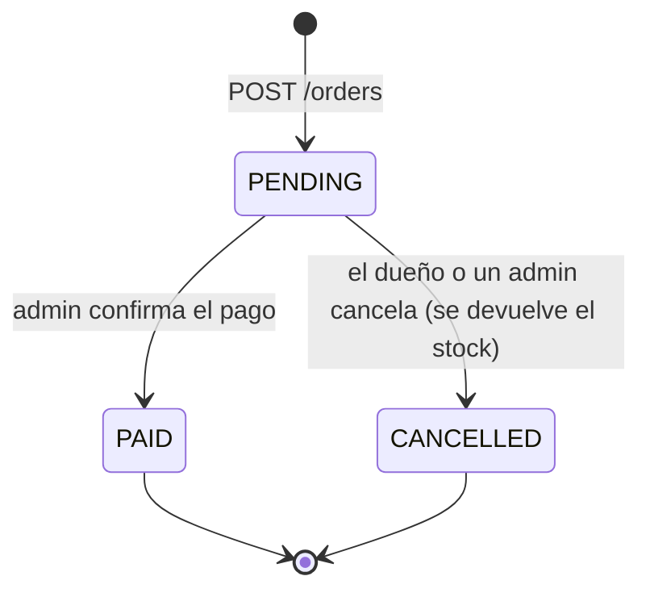

**Probarla desde la terminal** (con `AUTH_ENABLED=false`):

```bash
curl http://localhost:3000/health
curl "http://localhost:3000/products?name=Margarita"

# registrar un usuario y crear un pedido (reemplaza <ID_DEL_PRODUCTO> por el id que devolvió la línea anterior)
curl -X POST http://localhost:3000/users \
  -H "Content-Type: application/json" -H "x-dev-email: ana@javerianacali.edu.co" -H "x-dev-admin: false" \
  -d '{"name":"Ana","email":"ana@javerianacali.edu.co"}'

curl -X POST http://localhost:3000/orders \
  -H "Content-Type: application/json" -H "x-dev-email: ana@javerianacali.edu.co" -H "x-dev-admin: false" \
  -d '{"items":[{"productId":"<ID_DEL_PRODUCTO>","quantity":2}],"paymentMethod":"NEQUI","paymentReference":"987654321"}'
```

También puedes importar `postman/come-jave.postman_collection.json` en Postman o usar Swagger en `/docs`.

## 10. Flujo de la app

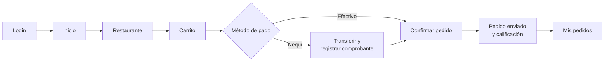

Detalles de experiencia de usuario:

- **Un restaurante por pedido:** si el carrito tiene platos de uno y se agrega otro de otro restaurante, la app pregunta antes de vaciarlo.
- **El carrito no se pierde al recargar:** se guarda en `sessionStorage` y se borra al cerrar la pestaña o al enviar el pedido.
- **Botón atrás del navegador y del celular:** cada pantalla queda en el historial, así que "atrás" regresa a la pantalla anterior en vez de salir de la app. Después de enviar un pedido no se puede volver a la confirmación.
- **Pago claro:** primero se elige el método y luego se continúa. En Nequi el número se copia con un toque, el campo del comprobante solo acepta dígitos y explica el error en línea.
- **Acciones con confirmación:** cancelar un pedido y cerrar sesión piden confirmación en un diálogo.
- **Pantallas vacías con salida:** carrito e historial vacíos ofrecen un botón para ir a pedir.
- **Accesibilidad:** foco visible con teclado, etiquetas ARIA en controles de solo ícono, errores anunciados con `role="alert"`, objetivos táctiles de al menos 44 px, campos de 16 px (sin zoom automático en iOS) y documento en `es-CO`.

## 11. Diseño, ilustraciones y animaciones

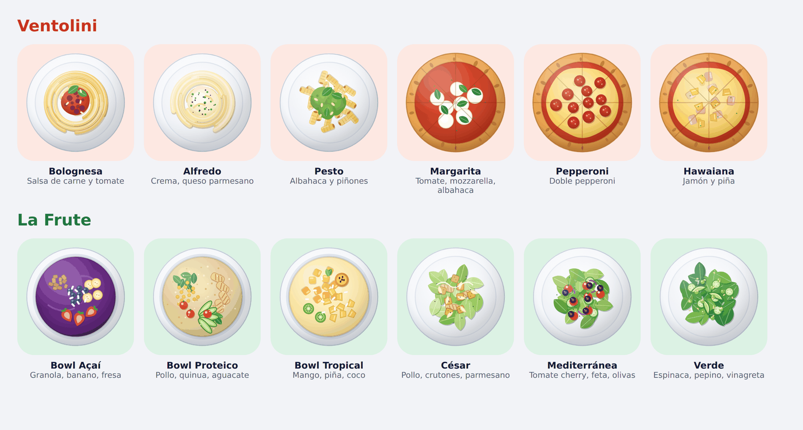

- **Color por restaurante:** Ventolini usa rojo tomate y La Frute verde fresco; el azul Javeriana queda para las acciones principales y el dorado para destacar.
- **Estilo iOS:** títulos grandes (Bricolage Grotesque, incluida con Fontsource, sin depender de Google Fonts), listas agrupadas, hojas inferiores para confirmaciones y barras translúcidas.
- **Instalable:** trae `manifest.webmanifest`, íconos (incluido maskable) e imagen para compartir el enlace, así que se puede agregar a la pantalla de inicio del celular.

### Ilustraciones propias de cada plato

Cada uno de los 12 platos tiene su propio dibujo visto desde arriba (spaghetti, fettuccine y penne; pizzas con sus ingredientes; bowls y ensaladas con sus componentes). Se generan con código en `src/components/comejave/dishes/`, sin azar: el mismo plato se ve igual en el servidor y en el navegador, en Android, iOS y escritorio.

### Fotos reales de los platos (opcional)

La app ya está lista para usar fotos reales; **no hace falta tocar código**:

1. Consigue una foto cuadrada de cada plato (propia o con licencia de uso). Recomendado: 600 × 600 px, WebP, menos de 80 KB.
2. Nómbrala con el **id del plato** (ver la tabla de la [sección 12](#12-menú)) y cópiala a `frontend/app/src/assets/dishes/`: `p1.webp`, `z2.jpg`, `b3.png`…
3. Corre `npm run dev` (o `npm run build`). Las fotos se detectan solas y se recortan en círculo.

Si a un plato le falta la foto, se muestra su ilustración, así que puedes subir las fotos de a poco.

### Animaciones con propósito

| Dónde | Qué hace |
| --- | --- |
| Login y portadas | Los platos flotan suavemente |
| Inicio y menú | Las tarjetas y filas entran de forma escalonada |
| Al agregar un plato | Rebotan la miniatura y el contador del carrito; la barra del carrito sube desde abajo |
| Categorías | El indicador se desliza entre Pastas/Pizzas o Bowls/Ensaladas |
| Pedido enviado | El check se dibuja, un aro se expande y sale confeti; las estrellas se encienden en cascada |

Todo se desactiva con `prefers-reduced-motion`.

## 12. Menú

| Ventolini | id | Precio | La Frute | id | Precio |
| --- | --- | --- | --- | --- | --- |
| Bolognesa | `p1` | $22.000 | Bowl Açaí | `b1` | $18.000 |
| Alfredo | `p2` | $24.000 | Bowl Proteico | `b2` | $21.000 |
| Pesto | `p3` | $23.000 | Bowl Tropical | `b3` | $17.000 |
| Margarita | `z1` | $26.000 | César | `e1` | $19.000 |
| Pepperoni | `z2` | $29.000 | Mediterránea | `e2` | $20.000 |
| Hawaiana | `z3` | $27.000 | Verde | `e3` | $16.000 |

El menú vive en `frontend/app/src/lib/comejave-data.ts` y en `src/database/menu.seed.ts`; **deben mantenerse iguales** (mismo `sku` y precios). El `sku` es `<restaurante>:<id>`, por ejemplo `ventolini:p1`.

**Para agregar un plato nuevo:** (1) agrégalo en `comejave-data.ts` y en `menu.seed.ts`; (2) corre `npm run seed`; (3) añade su ilustración en `components/comejave/dishes/` y regístrala en `registry.ts`, o sube su foto a `src/assets/dishes/`. Una prueba automática avisa si un plato del menú se queda sin imagen.

## 13. Pruebas y CI

Backend (desde la raíz):

```bash
npm run lint
npm run typecheck
npm test          # unitarias: guard de Firebase y validación de entorno
npm run test:e2e  # API completa con SQLite en memoria
```

Frontend (desde `frontend/app`):

```bash
npm run lint
npm run typecheck
npm test          # carrito, utilidades de auth, ilustraciones y fotos de los platos
```

Para correr los e2e contra PostgreSQL: `E2E_DB=postgres` más las variables `DB_*`.

La CI (`.github/workflows/ci.yml`) ejecuta todo lo anterior más el `build` de ambos proyectos en cada push a `main` y en cada pull request.

## 14. Despliegue

- **Frontend:** el `vercel.json` de la raíz instala y construye `frontend/app`. Configura en Vercel las variables `VITE_*` (Firebase, `VITE_API_URL`, `VITE_SITE_URL`…).
- **Backend:** cualquier servicio de Node con PostgreSQL. Define `NODE_ENV=production`, `AUTH_ENABLED=true`, `FIREBASE_PROJECT_ID`, las variables `DB_*` y `CORS_ORIGINS` con la URL del frontend; luego `npm run build`, `npm run seed:prod` (crea el esquema y carga el menú) y `npm run start:prod`. Con `DB_SYNCHRONIZE=false` las migraciones se ejecutan solas al arrancar.
- **Firebase:** habilita los proveedores Correo/Contraseña y Google, y agrega el dominio del frontend a los dominios autorizados.
- **Detrás de un proxy:** el límite de peticiones se cuenta por IP; si la API queda tras un proxy o balanceador, revisa que Express reciba la IP real del cliente (`trust proxy`).

## 15. Solución de problemas

| Problema | Qué hacer |
| --- | --- |
| El frontend dice "modo demo" y no guarda pedidos en la API | Faltan `VITE_API_URL` o las `VITE_FIREBASE_*`; deben estar las dos cosas |
| Error de CORS en el navegador | Agrega la URL del frontend a `CORS_ORIGINS` (sin barra final) y reinicia el backend |
| `Primero debes registrar tu perfil con POST /users` | El frontend lo hace solo al enviar el primer pedido; con `curl` primero crea el usuario |
| `"<plato>" no está disponible por ahora` al enviar un pedido | La API no tiene el menú cargado: corre `npm run seed` |
| El backend no arranca en producción | Con `NODE_ENV=production` se exige `AUTH_ENABLED=true`, `DB_SYNCHRONIZE=false` y `FIREBASE_PROJECT_ID` |
| Error al instalar `better-sqlite3` | Confirma que usas la versión de Node del `.nvmrc` (`nvm use`) y reinstala: `rm -rf node_modules && npm install` |
| Los datos de SQLite desaparecen al desplegar | Normal en discos efímeros; usa PostgreSQL |
| `Stock insuficiente` | Cada plato empieza con `SEED_STOCK` (200); cancelar un pedido devuelve el stock |
| El puerto 8080 está ocupado | Vite usa el siguiente puerto libre (8081…); agrégalo a `CORS_ORIGINS` si usas la API |

## 16. Ideas para seguir mejorando

- Panel para que cada restaurante vea y avance los pedidos (hoy el cambio a "Pagado" se hace por la API como admin).
- Campo `imageUrl` en los productos de la API para administrar las fotos sin recompilar.
- Notificaciones cuando el pedido esté listo.
- Pruebas de interfaz de punta a punta (Playwright) además de las actuales.

## 17. Equipo

Nicolás Cuastumal · Antonia Salguero · Nikolas Jimenez
Ingeniería de Sistemas y Computación, Pontificia Universidad Javeriana Cali.

> El repositorio no define una licencia (`UNLICENSED` en `package.json`). Si quieren que otras personas puedan reutilizar el código, agreguen un archivo `LICENSE`.
